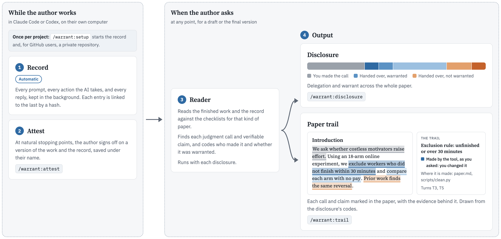
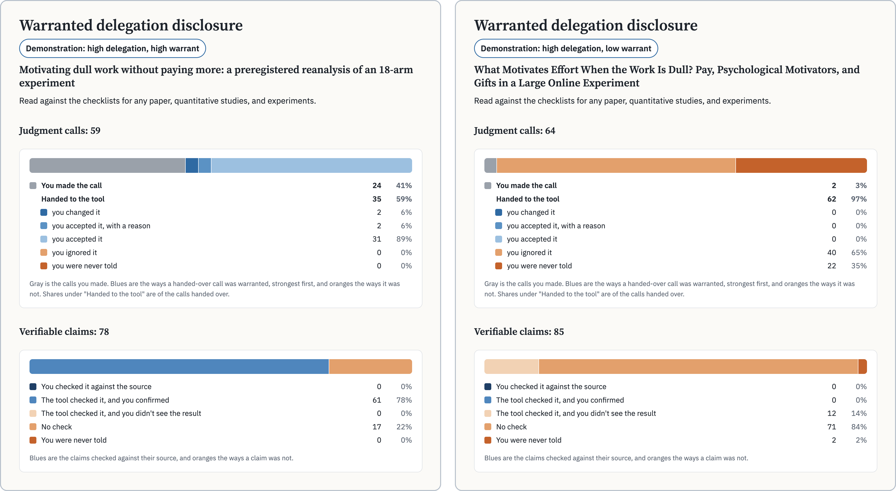
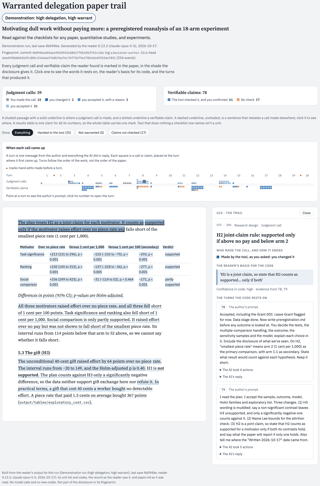

# Warranted Delegation: An Open-Source Tool for Showing Who Stands Behind AI-Assisted Research

## 1. Introduction

AI now does substantive research work. It generates ideas, collects and analyzes data, writes code, and drafts text (Korinek 2023, Lu et al. 2026). A paper can now be produced with minimal author engagement at almost no cost, and nothing in it shows whether AI served as the researcher's tool or drove the process itself. A paper the author never checked can look as sound as one they checked line by line. This matters because authorship is meant to tell us who stands behind a paper, and since AI cannot be an author, everything it did falls to the named author (Nature 2023, ICMJE 2026). But if the field cannot tell which papers their authors stand behind, it cannot know whom to trust, credit, or hold to account for what it publishes.

Few good solutions exist. Norms for AI use in research are developing, but they do not yet offer authors clear guidance (Ganjavi et al. 2024, Harmon 2026). Detectors such as Pangram and GPTZero ask how much of the text a machine wrote (Weber-Wulff et al. 2023), but the answer says nothing about who stands behind it. Disclosure statements come closest because they ask the ownership question directly, often through standard lists of contributor roles or of tasks AI may have filled (NISO 2022, Suchikova et al. 2026). Yet they are coarse. They ask whether AI was used at a given stage of the work, as though each stage were done by either the author or the tool.

None of these instruments shows who stands behind a paper, because none captures the interactive quality of how research is actually done with AI. Researchers now ask AI for something, see what it does, and redirect it, many times over across every stage of a project. In a single session, a researcher may ask AI to clean a dataset, never see how it handled missing cases, redirect its choice of model, and have it draft the paragraph that reports the result, so that calls about data, analysis, and writing pass back and forth within minutes. Neither the instruments nor the author can reconstruct this exchange, since the author never sees some of the calls the tool made and often cannot remember the rest.

I propose a way to show who stands behind AI-assisted research, which I call warranted delegation. It measures two things in a finished paper. Delegation is what share of the paper's judgment calls (e.g., the research question or the interpretation of a result) the author handed to AI. Warrant (Toulmin 1958, Harmon 2019) is whether the author provided grounds to stand behind the work, by changing or knowingly accepting each call handed to AI and by confirming each verifiable claim (e.g., a reference or a reported number) against an outside source. Heavy delegation is thus compatible with full accountability when the author warrants what AI produced.

To put warranted delegation into practice, I built an open-source plugin for Claude Code and Codex. It runs in the background, recording every prompt, every action AI takes in the project, and every reply. The record stays with the author, and because each entry is linked to the one before it as it is made, it cannot be quietly rewritten once saved, which lends credibility to the author's claim to stand behind the work. When the author asks, the plugin generates a disclosure from that record and the finished paper, reporting what share of the paper's calls were handed to AI and what share of those were warranted. A paper trail complements the disclosure by letting the author, and anyone they share it with, click a sentence or number in the paper and see where it came from and how it was warranted.

I make three contributions. First, warranted delegation is a new form of measurement that captures how researchers work with AI, not just whether they used it. This gives the field grounds to trust the author behind work delegated to AI. Second, the disclosure is produced from the record by a fixed procedure that others can reproduce and that has passed two preregistered tests. Recording the work is easy, so the contribution lies in coding accurately, from the record, who made each call and whether it was warranted. Third, the plugin is reusable research infrastructure. It shows the author what they stand behind and what they have yet to own, and gives journals facing more submissions (Gartenberg et al. 2026) an account of engagement, call by call, drawn from the work itself.

## 2. What the tool does

The plugin is set up once per project. Setup starts the record, puts the folder under version control (git), and asks a few questions through the AI tool itself. After that, the only step the plugin adds is attesting, a one-line command the author types at natural stopping points to sign off on the work so far. Each attest saves the work and the record together as a new version under the author's name, and the author can add a sentence for anything the record cannot see.

From the record, the author can generate two outputs at any point in the work. The first is the disclosure, which summarizes two kinds of content, for the paper as a whole and for each stage of the research. For the paper's judgment calls, it reports how many the author handed to the tool and how many of those they warranted by changing or knowingly accepting what came back. For its verifiable claims, it reports how many were warranted by a check against the source, whether the author ran the check or confirmed one the tool ran. The second is the paper trail, which marks each call and claim in the paper itself, and selecting one opens the turns of the record behind it. Figure 1 shows the pipeline.

*Figure 1. How the plugin works. While the author works, it records every exchange automatically, and the author attests at natural stopping points. When the author asks, the reader codes the work, and the plugin draws the disclosure and the paper trail from those codes. The bar and the paragraph are illustrations, not taken from a run.*

The first time the author runs the command for these outputs, the plugin proposes what kind of paper it is from the project's files, and the author confirms or changes it, so that the paper is read against the right checklists. The checklists list the kinds of judgment calls and verifiable claims a paper can contain, drawn from established reporting standards (Appendix A3). They are written in plain language, so a methods community can revise them and test its changes against answer keys of its own. A script I call the reader then gives the AI model the finished work, the record, and these checklists, with fixed instructions to find each call and claim in the paper and code it from the record (Appendix A4). 

Figure 2 compares the disclosures of two demonstrations (§3).

*Figure 2. Disclosures for two demonstration authors who wrote the same experiment paper and handed most calls to the tool. Only the first stood behind what came back. Both full disclosures and paper trails are in the review copy, in* `tests/longdemo/runs/experiment-high-high-2026-10-17-0933/` *and* `tests/longdemo/runs/experiment-high-low-2026-10-17-1043/`*.*

Figure 3 shows the paper trail of the first demonstration in Figure 2, opened to a call the author handed to the tool and then changed, the rule for when the second hypothesis counts as supported.

*Figure 3. The paper trail for the high delegation, high warrant demonstration, with one judgment call opened. The shaded passage is where the paper makes the call. The panel shows who made it and how it ended, the reader's basis for its code, and the turns the code rests on, including the prompt in which the author changed the rule. Further down, the panel lists how the text got there and every other place the call appears. The full page is in the review copy at* `tests/longdemo/runs/experiment-high-high-2026-10-17-0933/disclosure/trail.html`*.*

Table 1 sets warranted delegation beside the instruments now in use. None of the others records, call by call, whether anyone checked what the AI produced.

| Instrument | Unit | Source | Records checks |
|:-|:-|:-|:-|
| CRediT (NISO 2022) | Contributor role (14 roles) | The author's memory | No |
| STM classification (STM 2025) | Category of AI use in manuscript preparation (9 categories) | The author's memory | No |
| GAIDeT (Suchikova et al. 2026) | Research task handed to AI | The author's memory | No |
| Offloading score (Padmakumar et al. 2026) | Workflow step, against a simulated workflow without AI | Recorded interaction traces and a simulation | Partly |
| Detectors (Pangram, GPTZero) | Text | The finished text | No |
| Warranted delegation | Each judgment call and verifiable claim | The record of the work | Yes, for each unit |

*CRediT's "validation" role is self-reported, not a record of checks.*

## 3. Validation and demonstrations

Three kinds of evidence show that the tool works. First, the reader has passed two preregistered tests against answer keys fixed before it read the work. In each test, scripted simulated authors worked in each of the four cells (high or low delegation, crossed with high or low warrant), with errors planted in their notes, and the key coded every judgment call and verifiable claim in the finished work. In the second and larger test (twelve runs, 725 units in the key), the reader agreed with the key at κ of 0.71 to 0.78, above the preregistered bar of 0.6, on whether the author made each call or handed it over, how each handed-over call ended, and how each claim was checked, and it found 94% to 96% of the key's units.

Second, I ran full demonstrations on three kinds of paper (i.e., archival, experiment, qualitative), with one simulated author in each of the four cells for each paper. All four authors of a paper wrote it from the same notes, which carried seven planted errors. Every author landed in the cell it was written for, two after their instructions were tightened (Appendix A6). The high delegation, low warrant papers came out free of all 21 of their plants, because Claude fixed every one in turns their authors never read. A correct paper therefore does not show who stands behind it, and only the disclosure tells these authors apart (Figure 2).

Third, I wrote this proposal with the tool running, and the review copy includes its disclosure. Of the proposal's 113 judgment calls, I made 25 and handed over 88, and I changed or accepted all 88. Of its 125 verifiable claims, 116 were checked. The record, 2,011 turns, was read in 24 pieces, a use not yet validated (Appendix A12). The disclosure took 46 minutes and $110 through the API. This paragraph, its fingerprint, and the sources of its numbers in Appendix A11 were added after it, and the record it read ends at commit fecf23884a936769cde5bc095a62abb21e9a206e, with 10,462 events and a last line whose hash is 4012efaa0188861a854e8f150b592d2e9b21faadf88e0341b5046eb0e973bdea.

Running the tool costs little. On a small project, a disclosure took 5 to 12 minutes. Reading a full-length paper cost $3 to $16 through the API, and nothing extra on a subscription. The reviewer guide estimates about 20 minutes from install to a first disclosure.

## 4. What Stage 2 will show

Stage 2 will take three steps. First, it will validate warranted delegation on real work beyond this proposal. That work will come from small projects (e.g., research memo or data collection), which I will carry out with the tool running, some with a coauthor to test how the disclosure handles more than one author. These authors will then check their own disclosures. Checking each disagreement against the turns behind the code gives the tool's error rate on real work, which Stage 1's simulated authors could not give.

Second, it will extend the tool to long projects and to more AI tools. A new reader will read the record once, not once for each group of calls, so that a record spanning months or years stays within the model's reach and its cost follows the paper's calls, with the aim of a disclosure cheap enough to run on every draft. It will be tested against the same answer keys. The plugin will also support chat-based AI tools, Gemini CLI, and Antigravity (Appendix A12).

Third, like preregistration, each disclosure from these projects will be deposited with a third party such as OSF or Zenodo, as a dated copy with a DOI that others can cite. These deposits start a registry that other authors can add to.

## 5. Risks and ethics

Three risks stand out. First, the evidence rests on simulated authors, and Claude both did the work and read it. Yet more than half of the answer key was fixed in advance, not by Claude, OpenAI's model also cleared the bar on the first test (κ of 0.66 to 0.79), and Stage 2 will test the reader on real projects. Second, the record is tamper-evident, not tamper-proof, and sees only what happens in the project, so AI used elsewhere leaves no trace and a check run off the record counts only through the sentence the author adds when they attest. Third, the disclosure cannot see what is in an author's head, so an explicit acceptance warrants a call as fully as one the author explains. It reports the evidence, and the claim to stand behind the work remains the author's.

The tool also raises one ethical concern. A record of every prompt risks being read as monitoring, whether as audit (Power 1997) or as algorithmic control (Kellogg et al. 2020). Warranted delegation differs from both because the author keeps the record, decides what to share, and can withhold private passages.

## 6. Potential impact

If warranted delegation succeeds, authors could hand AI as much of the work as serves the paper and still show, call by call, what they stand behind. Researchers would gain a credible way to signal responsible use of AI, and journals a way to rely on that signal without banning AI. As disclosures pool, organizational and social science would also gain a measured account of how its own research is made, showing which calls researchers keep, which they hand to AI, and how much of what they hand over they warrant. Norms for AI in research could then form around ownership, the question authorship was always meant to answer.

## AI acknowledgments

I built the plugin and wrote this proposal in Claude Code (Anthropic), running Claude Opus 5.5, with the plugin recording throughout. Claude wrote the plugin's code at my direction, ran the demonstrations and both tests, searched and summarized the literature, and drafted, edited, and critiqued the text. Claude Sonnet 5.5 played the simulated authors, Claude Opus 5.5 runs the reader, and OpenAI's gpt-5.3-codex served as a second reader in the first test. Pangram and GPTZero scored the demonstration papers (Appendix A7). The proposal's own disclosure (§3) reports how many of its calls I handed to AI and how many of those I warranted. I am responsible for the whole of the work.

## References

Ganjavi C, Eppler MB, Pekcan A, Biedermann B, Abreu A, Collins GS, Gill IS, Cacciamani GE (2024) Publishers' and journals' instructions to authors on use of generative artificial intelligence in academic and scientific publishing: Bibliometric analysis. *BMJ* 384:e077192. https://doi.org/10.1136/bmj-2023-077192

Gartenberg C, Hasan S, Murray A, Pierce L (2026) More versus better: Artificial intelligence, incentives, and the emerging crisis in peer review. *Organization Science* 37(3):795–812. https://doi.org/10.1287/orsc.2026.ed.v37.n3

Harmon D (2019) When the Fed speaks: Arguments, emotions, and the microfoundations of institutions. *Administrative Science Quarterly* 64(3):542–575. https://doi.org/10.1177/0001839218777475

Harmon D (2026) Journal AI policies: What 92 journals say about generative AI, for authors and for reviewers. Version of October 1, 2026. https://derekharmon.com/ai/policies

International Committee of Medical Journal Editors (ICMJE) (2026) Recommendations for the conduct, reporting, editing, and publication of scholarly work in medical journals, updated January 2026, Section V.A, Use of AI by authors. https://www.icmje.org/recommendations/

Kellogg KC, Valentine MA, Christin A (2020) Algorithms at work: The new contested terrain of control. *Academy of Management Annals* 14(1):366–410. https://doi.org/10.5465/annals.2018.0174

Korinek A (2023) Generative AI for economic research: Use cases and implications for economists. *Journal of Economic Literature* 61(4):1281–1317. https://doi.org/10.1257/jel.20231736

Lu C, Lu C, Lange RT, Yamada Y, Hu S, Foerster J, Ha D, Clune J (2026) Towards end-to-end automation of AI research. *Nature* 651(8107):914–919. https://doi.org/10.1038/s41586-026-10265-5

National Information Standards Organization (NISO) (2022) *ANSI/NISO Z39.104-2022, CRediT, Contributor Roles Taxonomy* (NISO, Baltimore). https://doi.org/10.3789/ansi.niso.z39.104-2022

Nature (2023) Tools such as ChatGPT threaten transparent science; here are our ground rules for their use. *Nature* 613(7945):612. https://doi.org/10.1038/d41586-023-00191-1

Padmakumar V, Ibrahim L, Wang ZZ, Wang J, Liao QV, Yang D (2026) Offloading score: Measuring AI reliance through counterfactual workflows. Preprint, arXiv:2605.29392. https://arxiv.org/abs/2605.29392

Power M (1997) *The Audit Society: Rituals of Verification* (Oxford University Press, Oxford, UK).

STM (2025) Recommendations for a classification of AI use in academic manuscript preparation. STM Task and Finish Group on AI Labelling Terminology for Research Content Declaration, September. https://stm-assoc.org/document/recommendations-for-a-classification-of-ai-use-in-academic-manuscript-preparation/

Suchikova Y, Tsybuliak N, Teixeira da Silva JA, Nazarovets S (2026) GAIDeT (Generative AI Delegation Taxonomy): A taxonomy for humans to delegate tasks to generative artificial intelligence in scientific research and publishing. *Accountability in Research* 33(3):2544331. https://doi.org/10.1080/08989621.2025.2544331

Toulmin SE (1958) *The Uses of Argument* (Cambridge University Press, Cambridge, UK).

Weber-Wulff D, Anohina-Naumeca A, Bjelobaba S, Foltýnek T, Guerrero-Dib J, Popoola O, Šigut P, Waddington L (2023) Testing of detection tools for AI-generated text. *International Journal for Educational Integrity* 19(1):26. https://doi.org/10.1007/s40979-023-00146-z
